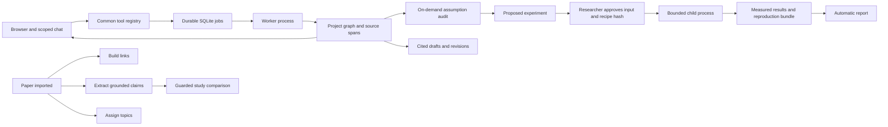

# Implementation decisions

Basis: `oct-21-2026-hackathon/shared/01-projects.md` through `04-ui.md` at repository commit `2da38c90cfacb554965677429d08b68ec6f39021`. Jackson explicitly authorized these four files as the design basis. The final vote document was still a template; these are resolved implementation choices, not invented class votes.

| Question | Implemented choice | Basis / reason |
|---|---|---|
| Runtime | Local modular monolith, FastAPI API + separate worker | Shared 02, pairs 01/03/04. One tool registry and stable graph IDs avoid importing independent student UIs. |
| Browser | Retain and extend pair-01's ES-module shell | Shared 04 explicitly includes the runnable no-build client. React is a future substitution, not needed for the tool contracts. |
| Database | SQLite WAL and immutable files, isolated database per project | Same local storage model as the proposals; per-project files make isolation explicit. One global API reservation ledger prevents splitting budgets between projects. |
| Graph | Typed nodes, typed edges, review status and provenance | Paper, passage, claim, assumption, topic, search, gap, dataset, experiment, run, grant, draft and report share identities. Review events are append-only. |
| Provider | Amplify adapter with durable cache and conservative reservations | Shared 01 disagreement D4: selected Jackson's provider pattern and incorporated the documented last-user-message `options.prompt` fix. |
| Discovery | OpenAlex, Semantic Scholar and arXiv adapters | Shared 01 merger M2; source outages are explicit. Search ancestry and candidate provenance survive saving. |
| Evidence | Direct Evidence Mapper source-span and comparison rules | Shared 01 M3/M10. Paper Radar-style structured extraction and Auditor-style retrieve/reconsider loop become separate handlers in one evidence pipeline. |
| Chat | Independent planner over the same catalog | Shared 01 D2. It can read and propose; approval endpoints are absent from its catalog. Six planner turns maximum. |
| Assumptions | Separate on-demand audit component | Shared 01 D3. Calls and literature checks are bounded; potential gaps are verified against retrieved context before storage. |
| Retrieval / topics | BM25 + TF-IDF, KMeans with actual silhouette selection | Shared 02 defaults. No embedding download, hosted vector service or invented clustering score. |
| Execution | Registry-only recipes in a child process | Shared 03 and Recipe Reviewer principle. Hash covers steps, base dataset, dataset IDs and content hashes. Worker rechecks approval and inputs before execution. |
| Chemistry | Core execution catalog first; no chemistry plugin | Shared 01 D5 donor-only option. No unsupported claims about a working RDKit/PubChem integration. |
| Funding | Live GrantScout-style search and identity resolution, transparent keyword screening | Current Grants.gov results with source timestamps; detailed eligibility review remains a researcher task. No fictional grants. |
| Writing | Grounded synthesis, independent review axes, selected revisions, diffs and response letters | Shared 01 M6. Exact draft quote verification and source-ID validation accompany model interpretation. Deterministic run briefs cite actual measured outputs. |
| Integration interface | Tool envelope + job/event endpoints + OpenAPI | Shared 03. IDs are project scoped; imports accept uploaded files, not model-generated filesystem paths. |
| Authentication | None; loopback-only single tenant | Hackathon scope. Host/origin checks protect local writes; do not expose this server publicly. |

## Research event chain

## Deliberate limits

The source proposals contain alternatives and exploratory features, not a unanimous requirement to implement every variant. This version implements the shared research workflow. It does not claim to implement open-ended autonomous code generation, every external chemistry database, an unlimited funding sweep, an ORCID write integration, PDF OCR, multi-user permissions, distributed services, or every proposed clustering backend. The UI and README state these limits rather than simulating them.
